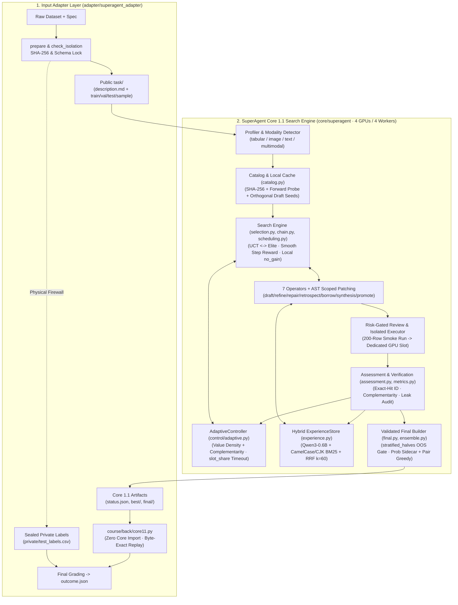

# SuperAgent（AIAA 3102）核心设计逻辑、搜索架构与路演深度 Q&A 报告

> **用途定位**：本报告面向课程项目路演汇报、架构答辩与深度 Q&A 准备，全面聚焦 **`Super_agent_core` 的项目总体工程设计、多分支进化搜索架构（Search Engine）、混合经验知识库、防过拟合集成体系与并发工程加固**；将预算预警、计费账本等纯工程护栏作为辅助运维附录简要说明。文中所有路径、符号名、超参默认值与测试/实测数据均严格取自当前代码库（分支 `developer`，离线回归测试 **`541 passed, 7 skipped`**）及 8×RTX 4090 实测记录。

---

## 一、项目定位与顶层设计哲学

### 1.1 为什么“单次 LLM 写代码 / 朴素重试”在真实 ML 工程中必然失效？
将大语言模型直接用于端到端自动化建模竞赛时，往往出现**四类结构性失效模式**：
1. **数据与验证集泄漏（Data & Validation Leakage）**：在训练集切分前做全局缩放、目标编码，或在最终用于对比筛选的 `val.csv` 标签上直接调融合权重与分类阈值（Validation Snooping），导致本地验证分虚高而盲测集大幅回撤。
2. **贪心搜索与分支坍缩（Greedy Search & Branch Collapse）**：开局多个并发线程易写出高度雷同的基线（如清一色默认 LightGBM）；缺乏系统性探索–利用切换、停滞突破与正反经验反馈，搜索迅速陷入局部最优，并行 worker 反复踩进相同的特征或 OOM 死胡同。
3. **脚本超时“死亡螺旋”（Timeout Death Spiral）**：若拿早期 15s 基线或 4s 崩溃脚本的分位数直接限制运行超时，后续多折 GBDT 与神经网络深度集成会在 25s 内被误杀，进而引爆连续无效的 `repair`（v0 实测 `31/120` 节点超时）。
4. **指标歧义与盲目集成退化（Metric Ambiguity & Blind Fusion）**：二分类硬标签下 `accuracy` 与 `precision_macro` 极易同率命中造成选型错位；离散预测丢失概率置信度（`0.51` 与 `0.99` 同票），且无验证门控的均值/投票极易混入弱模型拉低最优单模型成绩。

### 1.2 SuperAgent 的三条核心设计原则
针对上述根本问题，SuperAgent 确立了**“契约优先（Contract-First）、搜索驱动（Principled Search）、证据验证（Out-of-Sample Verified）”**三大核心工程法则：
- **原则一：前后端严格解耦与零泄漏边界（`Adapter <-> Core 1.1`）**
  - `adapter/superagent_adapter/` 承担输入校验、私有答案物理隔离（`private/test_labels.csv` 严禁进入 `task/`）、零交互默认并行度配置，以及结束后的纯粹离线复验（`course/back/core11.py`）。
  - `core/superagent/` 对具体数据集零硬编码，通过图像/表格/文本/多模态画像与预训练目录，依托纯文件系统契约完成高并发自主搜索与模型组装。
- **原则二：多分支进化树搜索 + 互补价值密度调度（Evolutionary Tree Search & Adaptive Control）**
  - 开局并发注入正交模型族假设，经由 **UCT 衰减探索 ↔ 分支分散化精英利用（`elite_pick`）**、**平滑相对增益奖励（`step_reward`）**、**并发安全的分支/全局停滞检测** 与 **7 大生命周期算子** 协同推进；
  - `AdaptiveController` 按**互补价值密度（包含相对全局最优的纠错互补率 `complementarity`）**与**多槽位原子提案（`rank_proposals`）**排序分配 GPU 算力，并彻底解耦调度耗时预估与槽位动态硬杀超时上限。
- **原则三：全链路防窥探与分层两半留出验证集成（Anti-Snooping & Stratified Two-Half Gate）**
  - 从 AST 与高风险规则审查、`200` 样本冒烟门控，到终选阶段基于 `stratified_halves` 的双半区交叉互验与可选离散概率旁路（`val/test_probabilities.csv` + `log_loss` 破平局 + `+2` 成对贪心），保证每一次交付要么统计显著优于最优单模型，要么安全退回最优单模型。

---

## 二、系统总体架构与前后端工程闭环

### 2.1 `Adapter` 适配层与物理防泄漏契约
1. **输入隔离与预检（`common/task_dir.py`, `course/front/prepare.py`, `course/runtime.py`）**
   - 将原始数据切分为公开 `task/`（仅训练/验证集、无标签测试集特征、`sample_predictions.csv` 模板）与隔离的 `private/test_labels.csv`。
   - `check_isolation()` 核验公开文件与标签列名、校验文件哈希并写入清单；`course/interactive.py` 为多卡服务器提供 `4 GPUs / 4 parallel / 16 CPUs` 零交互合理默认配置并按硬件实际容量安全夹紧。
2. **离线零代码执行验收（`adapter/superagent_adapter/course/back/core11.py`）**
   - Core 运行结束后，`core11.py` **不导入、不执行 Core 的任何模块与候选脚本**：
     - 核查 `status.json`、每个集成成员 `final/members/rank_*` 的符号链接必须指回其独立的 `runs/<node_id>/out/model` 目录且产物结构合法；
     - 依据 `final/source.json` 与 `combine.py` 记录的融合策略（`vote`、`string_vote`、`tokenwise_vote`、`average` 或 **`prob_argmax`**），离线读取成员预测或 `test_probabilities.csv`，在内存中重算并与 `final/predictions.csv` 做逐字节完全一致性校验，100% 匹配才进入最终私有评测。

---

## 三、核心设计深解：SuperAgent 的搜索架构五大支柱

这是整个项目最为核心、最具区分度的算法与系统工程部分。区别于传统 AutoML“线性脚本重写”或 `AIDE/MLEvolve` 相对简单的树搜索，SuperAgent 构建了一套**并发安全、模态感知、多算子协同、价值密度驱动**的演化搜索引擎。

### 3.1 支柱一：并发正交根部播种（`catalog.py::assign_draft_hypotheses`, `search.py::_startup`）
* **解决什么问题**：若 4 个并发 Worker 开局都直接调 LLM 写 `draft`，互相不可见代码，大概率各自独立写出几乎一模一样的基线（例如连续生成 3 份默认参数的 LightGBM），浪费搜索宽度；若改成 `MLEvolve` 式的串行写 3 个初稿，则开局即浪费十余分钟 GPU 空转。
* **设计机制**：
  - `Profiler` 自动判别数据集模态（`tabular` / `image` / `text` / `multimodal`）及可用本地预训练目录（已预先完成 `SHA-256` 校验与 `forward_ok` 前向探针）。
  - 启动阶段并发派发 `initial_drafts = 3`（错峰间隔 `draft_launch_stagger_seconds = 10s`，后续根节最多扩至 `max_drafts = 5`），通过 `assign_draft_hypotheses()` 为每个初始分支注入**结构正交的模型族假设**：
    - **表格任务**：在基线之外明确分工为 GBDT + 特征工程家族、Embedding-MLP / FT-Transformer 神经表征家族、CatBoost + ExtraTrees / HistGB 异构树家族，以及 `TabICL` 等本地表格先验（若可用）；
    - **视觉任务**：在多分类/微调架构间交错分配骨干，如 `ConvNeXt` 微调派、`DINOv2` 冻结表征提取派、`EfficientNetV2` / `Swin` / 轻量残差网络等；
    - **多模态任务**：覆盖晚融合（Late Fusion）、联合神经网络端到端训练与特征拼接 Stacking。
  - **代码生成策略（`codegen.staged`）**：初稿支持三段式结构化拆分编写（`data_prep` -> `model_def` -> `train_eval` 再整合），保证可插拔维护与后续局部打补丁的清晰符号边界。

### 3.2 支柱二：双阶段探索–利用树选择机制（`selection.py`）
SearchTree 在任意时刻通过 `select(tree, cfg, p, synthesis_ok, rng)` 在 **全局树探索（`tree_walk`）** 与 **分散式精英深挖（`elite_pick`）** 之间动态权衡：

1. **随搜索进度平滑衰减的探索权重 `explore_weight(p)`**
   - 设搜索进度 $p \in [0, 1]$（由已消耗时间/目标步数映射），配置默认 `switch_start = 0.5, switch_end = 0.7, min_weight = 0.2`：
     $$w_{\text{explore}}(p) = \begin{cases} 1.0, & p < 0.5 \\ 1.0 - (1.0 - 0.2) \cdot \dfrac{p - 0.5}{0.7 - 0.5}, & 0.5 \le p < 0.7 \\ 0.2, & p \ge 0.7 \end{cases}$$
   - 前 50% 预算保持 `100%` 树探索以建立多分支拓扑覆盖；`50%–70%` 线性过渡；后 30% 预算有 `80%` 概率聚焦高质量精英分支冲刺，同时保留 `20%` 探索概率防止早熟收敛。

2. **全局探索路径 `tree_walk`：带衰减系数的 UCT 算法**
   - 从 Root 出发递归评估已评估子节点 `ch.evaluated`：
     $$\text{UCB}(c) = \begin{cases} +\infty, & N_c = 0 \\ \dfrac{R_c}{N_c} + c(t) \sqrt{\dfrac{\ln N_p}{N_c}}, & N_c > 0 \end{cases}$$
   - 其中探索常数 $c(t)$ 随树规模 $t = |\text{nodes}|$ 按 `phase_ratios = [0.3, 0.7]` 从 `c_init = 1.414` 以 `decay_per_step = 0.01` 线性衰减至 `c_min = 0.5`：
     - $t < t_1 = \min(\text{max\_drafts} \cdot \text{max\_refinements}^2,\; \text{round}(0.3 \cdot \text{max\_steps}))$ 时保持 $c = 1.414$；
     - $t_1 \le t \le t_2 = \text{round}(0.7 \cdot \text{max\_steps})$ 时 $c(t) = \max(1.414 - 0.01(t - t_1),\; 0.5)$；
     - 后期保持 $0.5$。
   - **容量控制与冲突防护**：成功节点普通子节点上限 `max_refinements_per_node = 3`（不含精英扩选标记 `via_elite`）；失败节点修复子上限 `max_repairs_per_node = 1`（一旦任一子修复成功则停止额外修补）；根节最多 5 个初稿，并且选定顶层 draft 分支时立刻置 `in_progress = True` 防止多并发 Worker 重复扎进同一未展开根节点。

3. **深挖利用路径 `elite_pick`：分支多样性受限池 + 逆序加权采样**
   - **`elite_candidates()` 池构建规则**：直接从全树按验证分排好序的成功节点中挑选，但强制执行每条分支名额上限以防单一强势分支霸占全部精英名额：
     - 早期（$p < 0.7$）：选全局前 `early_k = 5` 个节点，每分支最多占 `early_per_branch = 3` 个；
     - 后期（$p \ge 0.7$）：收拢至前 `late_k = 3` 个，每分支最多占 `late_per_branch = 2` 个。
   - **逆排名加权采样（`weighted_rank_choice`）**：设候选排名为 $r \in \{1, \dots, k\}$，采样权重为 $w_r = 1 / r$，既强烈偏向榜首又不放弃次优分支。
   - **并发线程局部状态与链内软切换**：每个精英节点拥有更高的分支扩展上限 `elite_max_children = 10`；通过线程局部传递 `Dispatch.via_elite` 标志（而不直接篡改共享节点 `picked_by_elite`），消除多线程并发选取时的竞态覆盖；同时开启 `chain_soft_switch = true`，允许单条演化链每走一步前都按 $1 - w_{\text{explore}}(p)$ 的概率提前离开当前链转投全树精英。

### 3.3 支柱三：链式演进控制、平滑步进奖励与并发防停滞锁死（`chain.py`, `scheduling.py`）
当一个 Worker 沿着某条有效分支连续改进时，盲目无限深挖会让其余 3 路算力围观一条长链，或让共享计数产生并发竞态。SuperAgent 用四套精致机制管理链的生命周期：

1. **平滑相对增益奖励（`step_reward`）**
   - 采用 `reward_mode = "per_step"`，节点评估完毕立即反传奖励给整条祖先链：
     $$r(n) = \begin{cases} -1.0, & \text{失败或无有效分} \\ +0.5, & \text{所属分支首个成功节点} \\ 0.0, & \text{相对于分支此前最优的提升 } g < \text{min\_gain } (10^{-4}) \\ \min\!\Big(1.5,\; 0.75 + \dfrac{g}{\max(|s_{\text{prev}}|, 0.05)}\Big), & g \ge 10^{-4} \end{cases}$$
   - **设计意图**：微弱涨分（如 $+0.0002$）仅得基础奖励 $\approx 0.75$，而真正带来结构级突破的大幅涨分可平稳连续地攀升至上限 `1.5`，在 UCT 回溯时天然把后续搜索引导向“高突破潜力”的分支，而不是“反复刷千分之一微调”的分支。

2. **每节点本地无进展计数器（Per-Node Local `no_gain_count`）**
   - 早期共享全链 `chain_best.no_gain_count` 在多个并发布局同时汇报结果时会互相篡改计数。重构后改为**节点本地继承**：每个子节点评估时读取 `parent.no_gain_count`：
     - 若严格刷新 `chain_best`（$g \ge 10^{-4}$），本节点 `no_gain_count` 清零并更新自己的 `chain_best = n`；
     - 否则在本节点置 `no_gain_count = prev_no_gain + 1`，累计达到 `max_no_gain = 3` 即标记 `dead_end = True` 并终止当前链回退根节点。
   - **失败修复深度护栏**：连续修复深度达到 `repair_return_depth = 3` 强制释放链退回根节点重选，防止在无解错误上长期空转；超过 `max_repair_depth = 20` 永久标记死路。

3. **周期强制回退与最近最优豁免（`forced_return`）**
   - 当 $p \ge 0.4$（`mid_start`）且该分支累计完成步数每逢 `mid_every = 3` 的倍数，或当 $p \ge 0.8$（`late_start`）时以 `late_prob = 0.5` 概率触发强制回退，重新审视全局树与跨分支机会；
   - **防误杀关键细节**：若当前节点刚刚打平或超越最近 `recent_window = 4` 个节点中的最好成绩（`not better(best_recent.score, n.score)`），则**自动豁免强制打断**，乘胜追击高动量链条。

4. **并发安全的平台期判定（`_after_best_finished`）**
   - 4 路并发下，在最优节点 `best` **完工提交之前**早就派发出去的同分支兄弟节点若随后回报失败/微涨，不应被算作“刷新最优之后的停滞证据”。
   - 因此 `attempts_since_branch_best()` 对分支在 `best` 之后的尝试计数时（计入有效与失败尝试 `count_failed_attempts = true`），强制过滤条件为：
     `n.step > best.step and (n.created_at >= best.finished_at)`。
   - 正常链路停滞窗口为 `branch_window = 3`，高价值精英节点放宽至 `elite_branch_window = 6`，全局停滞窗口为 `global_window = 4`。

### 3.4 支柱四：7 类专业化进化算子协同 + AST 导入感知局部补丁（`operators.py`, `codegen.py`, `planner.py`, `patching.py`）
SuperAgent 在 `SearchTree` 与 `AdaptiveController` 上统一调度 **7 个职责正交的搜索算子**：

| 算子 | 触发时机与前置条件 | 核心工程与算法逻辑 | 模型/代码变更粒度 |
| :--- | :--- | :--- | :--- |
| **`draft`** | 启动期 `initial_drafts=3`（或根节点未满 `max_drafts=5`） | 结合 `method_catalog.yaml` 注入正交模型族假设，走三段式分段编写（`staged_drafting`）或整脚本生成并独立契约验收 | 全脚本构建（高多样性起点） |
| **`refine`** | 成功节点的常规精细演进 | 先由 `planner.structured` 基于正反历史经验输出受控实验计划，再由 `patch_coder` 进行精确锚点编辑；若连续 `ok_since_best>=2` 或 `all_since_best>=5` 则触发 **`escalation`** 升级，提示结构级架构跃迁 | 局部函数级微调 / 升级版跨组件重构 |
| **`repair`** | 节点崩溃、超时、`ArtifactError` 等异常 | 按错误日志片段定向检索同类修复经验执行补丁或全脚本重修；对**首次失败的生成初稿**额外给予 1 次层二挽救机会（即便已有更优 incumbent 也不直接抛弃新模型族火种），对孤立 `predict_only` 失败支持定向只修推理函数 | 定向 Bug / 推理修复 |
| **`retrospect`** | 分支触发停滞平台期（3 步无突破） | 回顾该分支上溯最多 **`max_steps = 10` 步的完整演化轨迹**（哪一步改特征涨分、哪一步加正则掉分），打破短视局部贪心并支持升级提示 | 基于 10 步长程轨迹的跃迁重构 |
| **`borrow`** | 搜索过半（$p \ge 0.5$）且处于平台期，在分支调度中与 `retrospect` 协同（默认概率 `0.3` / 或作为高价值提案接入） | 类似遗传算法交叉算子：从其他优秀分支挑选 Top 节点（`per_branch=2, max_refs=5`），把**捐献者分支（donor branch）的摘要与关键源码片段**注入当前分支上下文，跨流派嫁接特征或模型技巧 | 跨分支技术基因嫁接 |
| **`synthesis`** | 时间窗 $p \in [0.5, 0.8333]$、触发全树全局停滞（`global_window=4`）且至少 `min_branches=2` 条分支各有 $\ge 2$ 个成功节点 | 触发 `trigger_on_stagnation=true` 优先于新起草执行：从根节点重新综合多条独立分支的代表性方案（特征工程 + 异构模型融合架构），全局上限 `max_count = 2` 次 | 从 Root 重构多分支超融合骨架 |
| **`promote`** | 节点成功且保存了可恢复 Checkpoint（`can_continue=true` 且 `rung < max_rung=3`），上一轮确有训练进展（`optimizer_steps` 严格递增） | **Successive Halving 零大模型调用续训**：复用原脚本加载断点（`superagent.training`）加跑更多 epoch/iter，核验权重哈希推进且不触发任何 LLM 生成成本 | **0 LLM 调用**，纯 GPU 增量验证 |

* **规划–编辑链路的两个硬核工程创新（`planner.py` + `codegen.py` + `patching.py`）**：
  1. **自主模块选择（`target=None` Autonomous Planning）**：`planner.structured` 不再死板修改固定段，而是自主审查代码符号表 `_smart_source_excerpt()` 决定改动 `data_prep`（特征/增强/预分）、`model_def`（骨干/损失/结构）或 `train_eval`（优化器/调度/OOF）。
  2. **AST 导入感知作用域补丁（AST Import-Aware Scoped Patching）**：在 `planned_patch()` 执行 `<<<<<<< SEARCH / ======= / >>>>>>> REPLACE` 替换（支持缩进自动对齐）后，通过 Python AST 解析函数/类节点 `_allowed_change_ast()` 严格验证：**除计划指定的目标函数/符号及文件顶部 `import / from ... import` 外，其余全部无关代码必须 AST 等价不变**，既支持补丁安全引入新包（如 `catboost`、`torchmetrics`），又杜绝了模型“顺手改乱评估逻辑”的静默漂移！一旦补丁 2 轮未全覆盖所有变更，则安全回退 `script_coder` 完整重写并校验 `plan_coverage()`。

### 3.5 支柱五：互补价值密度调度与混合经验记忆（`control/adaptive.py`, `experience.py`）
1. **`AdaptiveController` 的并发报价与互补性价值密度排序**
   - 控制器在树锁内枚举所有可执行的候选 `(parent, action)` 提案（在 `choose()` 与无锁可审计纯函数 `rank_proposals()` 中协同生效），使用多槽位提案指纹 `slot` 避免同父同动作多个合法重试互相去重屏蔽，且剔除 `status == "cancelled"` 的取消态再统计配额。
   - 对每个提案计算单位预期时间内的**性价比优先级**：
     $$\text{priority} = \dfrac{\text{merit} \cdot \hat{p}_{\text{ok}}}{\max(\text{need\_secs}, 1)}$$
     $$\text{merit} = 0.2 + \underbrace{\frac{1}{1 + 0.12 \cdot \text{rank}}}_{\text{分数排名强度}} + \underbrace{\frac{0.4}{1 + |\text{children}|}}_{\text{子节点探索新颖度}} + \underbrace{\min(0.5,\; \text{complementarity})}_{\text{纠错互补红利}}$$
     其中 **`complementarity`** 在 `assessment.py:200` 实时计算：
     $$\text{complementarity}(n) = \frac{1}{|V|} \sum_{i \in V} \mathbb{I}\!\big(\hat{y}_{\text{best}}(i) \neq y(i) \;\land\; \hat{y}_{n}(i) = y(i)\big)$$
     即该节点**在验证集上改对了多少个“当前全局最优单模型做错的样本”**！这一设计让搜索树天然懂得为“未必拿第一、但与现有冠军高度互补”的异构分支（如神经模型 vs. GBDT）持续保留高优先级算力，直接赋能最终集成。
   - **定时每隔 `explore_every = 4` 轮强制插入探索提案**，避免高分局部 `refine` 彻底饿死 `draft / retrospect / borrow / synthesis`。
2. **解耦“期望耗时估计”与“动态槽位硬杀超时”（`script_timeout`）**
   - 优先级估算只纳入无崩溃的成功历史脚本分位耗时（并把超时样本计作删失下界 `censored_exec`），彻底剔除秒退异常脚本对分位数的向下污染；
   - 脚本运行时硬杀上限结合可用总剩余时间 $T_{\text{usable}}$、GPU 并发数 $P$ 与剩余目标节点 $N_{\text{rem}}$ 按槽位预算动态放缩：
     $$\text{slot\_share} = \frac{T_{\text{usable}} \cdot P}{\max(1, N_{\text{rem}})}, \quad T_{\text{kill}} = \min\!\Big(T_{\text{usable}}, T_{\text{max}}, \max\big(\min(0.5 T_{\text{usable}}, \max(T_{\text{min}}, 0.75 \cdot \text{slot\_share})),\; 2.5 \cdot q_{0.8}(\text{ok})\big)\Big)$$
     （短测试自动收敛到 `~40s`，1 小时运行兜底 `300s+`，6 小时运行自动扩窗到 `1000s+`，把超时误杀率从 `25.8%` 压至 `1.8%`）。

3. **对比式混合经验知识库（`ExperienceStore`：`Qwen3-Embedding-0.6B` + `CamelCase/CJK BM25` + `RRF`）**
   - **双路索引**：
     - 稠密语义检索（CPU 本地加载 `Qwen/Qwen3-Embedding-0.6B`，`1024` 维余弦相似度阈值 $\ge 0.35$，零 GPU 显存抢占与零外部向量 API 依赖）；
     - 稀疏词法检索（Okapi BM25，$k_1 = 1.5, b = 0.75$，**新增 CamelCase 驼峰分词 + CJK 中文分词**：例如 `StratifiedKFold` 自动切分为 `['stratifiedkfold', 'stratified', 'kfold']`，既精确匹配源码库/异常符号，又能跨词汇形态召回）。
   - **倒数秩融合（RRF）与正反双证据注入**：
     $$\text{RRF}(i) = \frac{0.5}{60 + r_{\text{kw}}(i)} + \frac{0.5}{60 + r_{\text{vec}}(i)}$$
     每次规划注入 **Top-2 正向涨分经验（`effect = +1`）** 与 **Top-2 负向失败/掉分经验（`effect = -1`，且优先纳入当前父节点的直系失败子节点作为强约束反例）**，阻止同构/跨分支在相同方向反复试错。

---

## 四、防验证集窥探与可验证集成体系（`review.py`, `metrics.py`, `final.py`, `ensemble.py`）

搜索出高分与多样候选后，最终交付决定实际泛化上限的是三道刚性防线：
1. **防验证集窥探准则 + 静态/动态泄露审计（`review.py`, `assessment.py`, `metrics.py`）**
   - Prompts 与高风险审查严格禁止在最终 `val.csv` 上调融合权重或搜索阈值（必须全部放在训练集内折 OOF 完成）；运行后触发 `high_threshold=0.999` / `jump_ratio=0.2` 跳变级 LLM 审计。
   - `identify_metric()` 引入 **`(命中数 hits, 题面显式提示 hinted, 1e-4 精确命中 exact_hits, 主指标顺序, -误差)`** 多级消歧，彻底消除硬标签二分类下 `accuracy` 与 `precision_macro` 误判。
2. **确定性类别分层双半留出验证门控（`final.py::stratified_halves`）**
   - 候选集按 `top_per_branch = 5` 与 `member_overlap >= 0.9` 约束截断后，调用 `stratified_halves()` 按真实类别分层确定性将共同验证样本拆分为互不相交的 **Half A** 与 **Half B**：
     - 在 A 上拟合离散投票权重 / 概率平均权重，并在盲半区 B 上打分；再对调在 B 上拟合、A 上打分；
     - **严格双赢准入准则**：只有候选集成方案在 A 和 B 两个独立留出半区均以 $\ge \text{min\_gain } (10^{-4})$ 击败全局最优单模型时才接受集成；否则 `Zero-Harm Fallback` 安全交付最优单模型。
3. **校准概率旁路与 `+2` 成对离散贪心（`ensemble.py`）**
   - 在保留契约标准 `predictions.csv` 不变的前提下，引导候选脚本额外保存 `val_probabilities.csv` / `test_probabilities.csv`（或通过兼容解析器提取校准概率），启用 `prob_argmax` 软加权集成；在精度打平时（$<10^{-9}$），若双半区交叉熵 `log_loss` 均下降 $> 0.001$ 仍予以准入以提升测试概率边界鲁棒性。
   - 在纯离散硬投票模式中增加 **`+2` 成对联合步进搜索**，打破原来从 `[1, 0, ...]` 单次加一永远 1:1 平票锁死头名权重的拓扑陷阱。

---

## 五、真实多模态基准实测、同题对标与全套单测验证（8×RTX 4090）

### 5.1 跨模态多分支检索与端到端表现
- **`Intel Image Classification`（6 类自然场景，`14,034` 训练 / `3,000` 密封测试图）**：
  - 核心引擎零改动自动切入 `image` 模态，在 5 个分支共探索 `85` 个节点，有效节点 `72` 个（**成功率 `84.7%`**），仅 2 次超时；
  - `stratified_halves` 验证门控自动接受 `top6` 异构视觉骨干（ConvNeXt / Swin / EVA-02 等）融合，在 3,000 张密封测试集上取得 **95.33% Accuracy（Macro-F1 95.45%）**，稳定高于最优单模型（`95.13%`）。
- **`Playground S6E10 Airline Satisfaction`（`70,000` 训练 / `10,000` 验证 / `20,000` 密封测试行）**：
  - **消除超时螺旋**：将调度估计与动态 `slot_share` 杀限解耦后，超时被杀节点从 `31/120 (25.8%)` 暴降至 **`1/57 (1.8%)`**，有效节点产出率由 `65.0%` 跃升至 **`86.0%`**；
  - **修复指标与验证对齐**：消除混合 OOF 与固定 `val.csv` 之间 `0.37%` 评分漂移并精确锁定 `accuracy`，以 `issues: []` 全项通过 `core11.py` 与 `course` 验收。

### 5.2 同硬件同题受控对标：`SuperAgent` vs. `MLEvolve`（4×RTX 4090, 1h, DeepSeek）

| 搜索与模型核心维度 | 修改前 `SuperAgent` (`v0`) | 升级后 `SuperAgent` (`v1`) | 基线 `MLEvolve` (`1h`) | 架构优劣归因 |
| :--- | :---: | :---: | :---: | :--- |
| **1 小时搜索总节点 / 有效节点** | `120` / `78` (`65.0%`) | **`57` / `49` (`86.0%`)** | `30` / `27` (`90.0%`) | 吞吐为 `MLEvolve` 的 **`1.9 倍`** |
| **零大模型调用续训（`promote`）** | `0` | **`11` 次** | `0`（依赖 LLM 重生成） | Successive Halving 复用 GPU 预算 |
| **超时被杀节点数** | `31` 个 (`25.8%`) | **仅 `1` 个 (`1.8%`)** | `0` 个 | 动态 `slot_share` 彻底消除误杀螺旋 |
| **`course / core11` 契约验收** | ❌ 指标歧义拒收 | ✅ **100% 通过 (`issues: []`)** | 不具备外部离线确定性重放验收 | 物理防火墙 + 字节精确重放 |
| **主选交付密封测试集 Accuracy** | `92.180%` | **`92.175%`** | `92.170%` | 主交付保持同等略优泛化水平 |
| **全场发现最优单模型（密封测试）** | — | **`92.245%` (`rank_06`)** | `92.235%` (`top3`) | 多分支正交 + 互补搜索挖出更强异构模型 |
| **终选融合策略** | — | `v1`: 安全留出门控 → **`v2`: 概率旁路 + 分层 OOS 门** | `92.205%` (`top4ens` 无验证盲融合) | 直接促成通用的校准概率旁路与防窥探法则 |

### 5.3 工程加固集成与全量离线测试回归
在合并多轮并发搜索健壮性、AST 补丁作用域放宽、CamelCase+CJK 分词检索、类别分层两半检验以及隔离环境修复（`core/tests/test_engineering_hardening.py` + `adapter/tests/test_adapter_hardening.py`）后，完整离线单元测试回归结果为：**`541 passed, 7 skipped`（0 失败）**。

---

## 六、工程运维与轻量级护栏附录（简述）

> 在项目顶层设计中，令牌经济与预算护栏定位为支撑搜索稳定运行的**轻量工程辅助设施**（而非核心算法叙事中心）：
1. **角色分层思考策略（`llm/role_policy` & `review.mode: "risk"`）**：仅对真正需要算法创造力的 `planner.structured`、`draft_writer.*`、`draft_integrator`、`script_coder`、`leak_checker` 保持高思考强度；关闭机械翻译补丁 `patch_coder` / `repair_coder` 的冗余 Thinking，并将 `reviewer` 改为仅触及 `split / fold / target / metric / read_csv / threshold / blend / stack` 变更的高风险门控。此举在**不损伤规划创造力**的前提下将推理 Token 压缩 `68.8%`（单步延迟骤降，助推搜索吞吐达到 `MLEvolve` 的 1.9 倍）。
2. **可选请求账本与软预算收尾（`operations.sqlite` & `CostCapRule`）**：若部署时设置了成本上限，网关在发送前写入 SQLite WAL 预留记录、异常截断时自动扩窗降级恢复；达到预警水位后仅停止新开节点并等待在途 GPU 节点正常收尾，保障搜索成果完整落盘集成。

---

## 七、路演深度 Q&A 防守手册（10 个核心架构与搜索深水区追问）

### Q1：SuperAgent 相比开源 AIDE 或 MLEvolve，在“搜索本身”的设计上最本质的优势是什么？
**答**：核心优势集中在**正交多流派并发起步、分支多样性约束与互补感知调度**：
1. **并发正交起步（vs. MLEvolve 串行写初稿）**：`assign_draft_hypotheses()` 按数据模态在 $t=0$ 并发给 4 个 Worker 派发互斥模型族，兼具启动速度与家族分散度；
2. **防局部贪心的 7 算子闭环**：除 `draft/refine/repair` 外，我们独创或强化了 `10` 步长程轨迹 `retrospect`、跨分支基因移植 `borrow`、全局停滞根部合流 `synthesis`，以及零 LLM 成本的 `promote` 断点续训；
3. **误差互补驱动与对比记忆**：`AdaptiveController` 不仅看父节点分数高低，还通过 `complementarity` 显式奖励“改对了全局冠军做错的样本”的异构分支；同时 `ExperienceStore` 同时注入正向 `+1` 与负向 `-1`（优先直系失败子）案例，比单向 RAG 更能止损防重踩。

### Q2：并发环境下 4 个 Worker 同时读写搜索树，是如何彻底解决多线程序列化竞态与计数错乱的？
**答**：我们从状态归属、时间筛选和调度提案三层彻底消除并发竞态：
1. **每节点本地化状态**：把最易互相覆盖的链无进展计数从共享 `chain_best` 迁入每个 `Node` 自身（`prev_no_gain -> node.no_gain_count`），并通过线程局部传递 `Dispatch.via_elite` 标志，不污染共享父节点；
2. **时间顺序平台期过滤（`_after_best_finished`）**：判断分支平台期时，严格要求计数候选满足 `n.created_at >= best.finished_at`，避免最优解诞生前已经起飞的并行在途任务“背锅触发误停滞”；
3. **非取消配额与多槽位键（`rank_proposals`）**：`status == "cancelled"` 的取消动作不挤占父母分支孩子名额，并用递增 `slot` 区分合法多次修补或再精调，同时提供纯无锁 `Snapshot -> Proposal` 可审计排序路径。

### Q3：`borrow` 和 `synthesis` 同为跨分支机制，二者定位有何区别？何时触发？
**答**：
- **`borrow`（微创横向嫁接，像基因交叉）**：面向**单条陷入局部停滞的分支**，在搜索过半（$p \ge 0.5$）后触发。它会把其他高分分支的方法卡片与关键代码摘录注入当前分支的规划上下文，将对方有效的特征构造、增强或损失函数技巧嫁接到当前树架构上，保留当前分支骨架继续生长；
- **`synthesis`（宏观根部重组）**：面向**全树全局平台期**（连续 `global_window = 4` 步无全局突破），在窗口 $p \in [0.5, 0.8333]$ 且至少有 2 条分支各拥有 $\ge 2$ 个成功节点时，直接从 **Root** 重新发起，收集各分支最优代表方案，统一重组出跨家族特征与融合骨干（限最多触发 `max_count = 2` 次）。

### Q4：`step_reward` 为什么要改成 `[0.75, 1.5]` 的相对增益函数，而不是固定 `1.0`？
**答**：若所有严格刷新最优的改进都固定给 `+1.0` 奖励，那“连续做 3 次 `+0.0001` 参数微调”的平庸分支累计奖励就会轻易反超“某一步突然暴力涨分 `+3%` 的强结构分支”，导致 UCT 算法把后续算力抽向挤牙膏型分支。平滑公式 $\min(1.5,\; 0.75 + g / \max(|s_{\text{prev}}|, 0.05))$ 让大跨越获得最高 `1.5` 倍率正反馈、微幅波动仅得 `0.75`，更贴合高价值科学发现的搜索偏好。

### Q5：`complementarity`（互补性）在搜索期怎么用？为什么不能只靠“最高分优先”？
**答**：在机器学习竞赛中，全靠最高分选父节点很容易让全部 4 张 GPU 全去堆调优同一个 GBDT 分支，导致 Top-6 模型高度同质、无法在终选时形成有效集成提升。`assessment.py` 每次评估完有效节点都会计算其相比全树全局冠军额外答对样本比例 `complementarity = np.mean((old != truth) & (new == truth))`。`AdaptiveController` 将 `min(0.5, complementarity)` 直接计入提案 `merit`，让具备高纠错互补潜力的异构分支（例如树模型之外表现不俗的神经表征模型）在调度竞争中拿到充足展开机会，从而既能搜索更高分单模，又把好料留给终选集成。

### Q6：为什么要把 `patch_coder` 的代码编辑限制在“计划目标符号 + 顶部 Imports”的 AST 作用域内？
**答**：长脚本中如果允许 LLM 自由全局打补丁，模型在修改 `train_eval` 超参时常出现“幻觉式顺手修改特征切分或验证评估函数”的现象，造成隐式对比基准漂移。`codegen.py` 通过 Python AST 解析精确隔离目标函数体并允许同步追加文件顶部 `import`/`from` 语句（`_allowed_change_ast`），配合 `plan_coverage` 确认所有计划改动落地，兼顾“允许引入新机器学习库”的灵活性与“评估不变量 100% 锁定”的可靠性。

### Q7：为什么混合经验库选用 `Qwen3-Embedding-0.6B` + `CamelCase/CJK BM25` 的 `RRF` 组合？
**答**：ML 实验检索同时需要**跨表述语义泛化**（如“用 Label Smoothing 和余弦退火稳定 CNN 微调”）和**精确程序词元匹配**（如 `StratifiedKFold`、`CatBoostError`、`CUDA out of memory`）。
- 本地 CPU 运行 `Qwen3-Embedding-0.6B`（1024 维，阈值 `0.35`）彻底零显存抢占与零外部 API 费用；
- 对 Okapi BM25 新增 CamelCase 拆词（如 `StratifiedKFold` 同时生成原词与 `stratified / kfold` 子词元）及 CJK 词元支持，避免驼峰标识符被整串当成孤立长词漏召回；
- 用无参数尺度依赖的 `RRF (k=60)` 融合，并以 **Top-2 `+1` 正向收益 + Top-2 `-1` 负向反例（优先直系失败子）** 形式双向提示 Planner 避坑。

### Q8：如何从架构与验证机理上彻底杜绝“测试泄漏”和“验证集过拟合”？
**答**：采用四道纵深防御：
1. **物理路径防火墙**：`Adapter` 将 `private/test_labels.csv` 锁定在 Core 完全不可见的外部目录并做文件 SHA-256 锁定；
2. **预审 + 防验证窥探规则**：高风险 `reviewer` 拦截全表 pre-split 缩放及在 `val.csv` 上搜权重/阈值等窥探行为；运行后跳变触发深度 `leak_checker`；
3. **指标消歧**：`task-hint + 1e-4 exact_hits` 防止硬标签多指标数值碰撞误选；
4. **`stratified_halves` 双半区互验门**：在类别分层的 disjoint Half A/B 上交叉拟合权重并各自留出评分，两半均显著击败最优单模型（或分数持平但概率 `log_loss` 降 $>0.001$）才准入集成，否则安全退回单冠军。

### Q9：离散硬标签下如何恢复软置信度实现有效集成，又不破坏 `core11.py` 离线契约验证？
**答**：契约规定主预测 `predictions.csv` 保持比赛原始离散格式不变，我们在旁边新增可选配边车 `val_probabilities.csv` 和 `test_probabilities.csv`。`final.py` 用概率旁路做加权软平均后再 `argmax` 出最终标签、在离散分平局时用 `log_loss` 裁决，并同步升级离散投票为 **`+2` 成对贪心** 打破 `[1, 0, ...]` 的 1:1 投票死锁。最终写入成员包与 `combine.py` 配方，`adapter/course/back/core11.py` 无需跑一行模型代码即可离线逐字节重算校验通过。

### Q10：系统当前仍存在的工程局限与下一步演进计划？
**答**：
1. **跨分支一级节点复用二级 Stacking**：目前异构模型集成仍需各自产出预测后再融合，或靠单脚本重训多个基模型；后续计划依托全树已保存的同分割校验 OOF 与特征包构建专用二阶 Stacking 算子，大幅提高大模型混合效率。
2. **连续任务与跨任务去敏元知识沉淀**：将当前两半防过拟合门控与概率旁路思路拓展至长回归（RMSE/Quantile）与序列/检测结构化任务，并在严格脱敏前提下提炼通用无泄露方法卡跨任务迁移。
3. **关于大家可能关心的开销控制问题（简要补充）**：通过“高创造力角色保留思维链 + 机械补丁取消思考 + 高风险门控审查”的角色分级与可选 SQLite 账本，SuperAgent 在保持更深搜索能力的同时单节点成本低至 MLEvolve 的 67%、整体耗时更紧凑。
